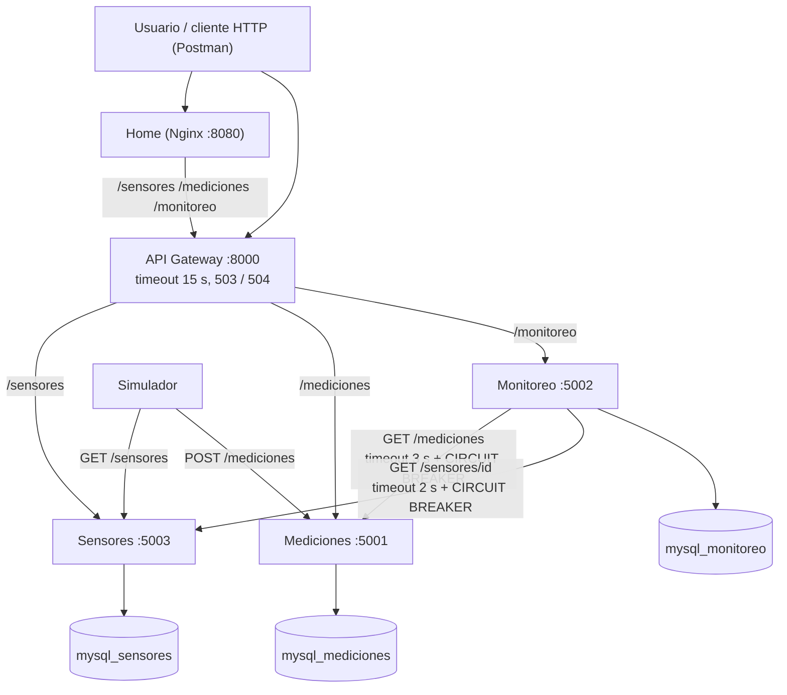

# AgroSense — Sistema Distribuido de Monitoreo IoT (Simulado)

## Problema que resuelve

En zonas rurales o alejadas, con acceso limitado a energía eléctrica e internet, es
difícil realizar un monitoreo constante de variables ambientales como temperatura,
humedad, calidad del agua, estado del suelo y calidad del aire. La falta de datos
digitalizados y actualizados dificulta la toma de decisiones en actividades como la
agricultura, la investigación ambiental y el cuidado de los recursos naturales.

El sistema resuelve esto mediante una red de sensores IoT **simulada** que genera,
transmite y centraliza datos ambientales, facilita su consulta y análisis, y genera
alertas cuando los valores salen de los umbrales configurados.

## Objetivo

Diseñar y materializar, mediante contenedores, una solución distribuida basada en
microservicios que reciba, almacene y analice mediciones de sensores simulados, con una
vista Home como punto de entrada del usuario.

## Integrantes y roles

| Integrante | Rol principal |
|---|---|
| Nicolas Gaviria | Arquitectura, Docker Compose e integración |
| Jainer Chocue | Servicios Mediciones y Monitoreo (APIs REST) |
| Sebastián Paja | Dockerfiles y contenerización de los servicios |
| Freyder Pacho | Vista Home y documentación |

## Arquitectura

Arquitectura de **microservicios** con estilo cliente–servidor. Cada servicio con
persistencia tiene su **propia base MySQL**; los servicios se comunican por
**HTTP/REST con JSON** dentro de la red `red_iot` de Docker Compose. El usuario entra
por **Home** (Nginx); todas las peticiones de datos pasan por el **API Gateway**, único punto de
entrada hacia Sensores, Mediciones y Monitoreo. Solo se publican Home (`8080`) y el Gateway (`8000`).



Detalle completo en [docs/arquitectura/ARCHITECTURE.md](docs/arquitectura/ARCHITECTURE.md).

## Servicios

| Servicio | Responsabilidad | Puerto | Se comunica con | Documentación |
|---|---|---|---|---|
| **API Gateway** | Punto de entrada único: enruta `/sensores`, `/mediciones` y `/monitoreo`, conserva códigos de estado y responde 503/504 | `8000` | Sensores, Mediciones, Monitoreo | [servicio-gateway](docs/servicios/servicio-gateway.md) |
| **Home** | Interfaz web (Nginx); reenvía las rutas de datos al Gateway | `8080` → 80 | Gateway | [servicio-4-home](docs/servicios/servicio-4-home.md) |
| **Mediciones** | Registrar y consultar lecturas | `5001` | MySQL propio | [servicio-1-mediciones](docs/servicios/servicio-1-mediciones.md) |
| **Monitoreo** | Resúmenes, umbrales y alertas; protege sus llamadas con timeout y Circuit Breaker | `5002` | Mediciones, Sensores, MySQL propio | [servicio-2-monitoreo](docs/servicios/servicio-2-monitoreo.md) |
| **Sensores** | Catálogo de sensores | `5003` | MySQL propio | [servicio-sensores](docs/servicios/servicio-sensores.md) |
| **Simulador** | Generar lecturas y enviarlas a Mediciones (sin API) | — | Sensores, Mediciones | [servicio-3-simulador](docs/servicios/servicio-3-simulador.md) |

## Endpoints

Las rutas son las mismas directamente en cada servicio y a través del Gateway (`:8000`). Ejemplos para
Postman en [docs/endpoints/](docs/endpoints/).

### Mediciones (`:5001`)

| Método | Ruta | Descripción |
|---|---|---|
| GET | `/health` | Estado del servicio y de la BD |
| POST | `/mediciones` | Registrar una medición |
| GET | `/mediciones` | Listar (filtros `sensor_id`, `id`, `limit`) |
| GET | `/mediciones/<id>` | Obtener una medición |
| GET | `/mediciones/sensor/<sensor_id>` | Mediciones de un sensor |
| PUT / PATCH | `/mediciones/<id>` | Reemplazar / actualizar parcialmente |
| DELETE | `/mediciones/<id>` | Eliminar |

### Sensores (`:5003`)

| Método | Ruta | Descripción |
|---|---|---|
| GET | `/health` | Estado del servicio y de la BD |
| GET | `/sensores` | Listar (filtros `tipo`, `activo`) |
| GET | `/sensores/<id>` | Obtener un sensor |
| POST | `/sensores` | Crear |
| PUT | `/sensores/<id>` | Reemplazar |
| DELETE | `/sensores/<id>` | Eliminar |

### Monitoreo (`:5002`)

| Método | Ruta | Descripción |
|---|---|---|
| GET | `/health` | Estado del servicio y de la BD |
| GET | `/monitoreo/<sensor_id>` | Resumen del sensor (`404` si no hay lecturas) |
| GET | `/monitoreo/resumen-general` | Métricas globales |
| GET | `/monitoreo/evaluar/<sensor_id>` | Evalúa la última lectura contra su umbral y registra alerta |
| GET / POST | `/monitoreo/umbrales` | Listar / crear umbrales |
| GET / PUT / DELETE | `/monitoreo/umbrales/<id>` | Obtener / reemplazar / eliminar un umbral |
| GET | `/monitoreo/alertas` | Listar alertas (filtros `sensor_id`, `limit`) |
| DELETE | `/monitoreo/alertas/<id>` | Eliminar una alerta |

## Bases de datos

Tres instancias MySQL 8.0 independientes, cada una con su volumen. Los servicios crean
su base y sus tablas al arrancar (requieren un usuario con `CREATE`; `root` sirve).
Scripts de referencia en [bases_datos/](bases_datos/).

| Servicio | Contenedor | Base | Tablas |
|---|---|---|---|
| Mediciones | `mysql_mediciones` | `mediciones` | `mediciones` |
| Sensores | `mysql_sensores` | `sensores` | `sensores` |
| Monitoreo | `mysql_monitoreo` | `monitoreo` | `umbrales`, `alertas` |

## Variables de entorno

Se definen en `.env` (copiar de [.env.example](.env.example)). Todas tienen valor por
defecto en `docker-compose.yml`, por lo que `.env` es opcional.

| Variable | Uso | Por defecto |
|---|---|---|
| `MYSQL_ROOT_PASSWORD` | Contraseña root de los tres MySQL | `root` |
| `DB_USER` | Usuario con el que los servicios se conectan | `root` |
| `DB_PASSWORD` | Contraseña de ese usuario (igual a `MYSQL_ROOT_PASSWORD` si es `root`) | `root` |
| `DB_PORT` | Puerto de MySQL | `3306` |
| `INTERVALO_SEGUNDOS` | Segundos entre envíos del Simulador | `5` |
| `MEDICIONES_TIMEOUT` | Timeout (s) de Monitoreo y Simulador hacia Mediciones | `3` |
| `SENSORES_TIMEOUT` | Timeout (s) de Monitoreo y Simulador hacia Sensores | `2` |
| `GATEWAY_TIMEOUT` | Timeout (s) del Gateway hacia cualquier servicio | `15` |
| `CB_MAX_FAILS` | Fallas técnicas seguidas que abren el Circuit Breaker | `3` |
| `CB_TIMEOUT` | Segundos en `OPEN` antes de la solicitud de prueba (`HALF_OPEN`) | `10` |
| `DELAY_SEGUNDOS` | Demora inicial simulada de Mediciones (pruebas de Timeout) | `0` |

Compose fija además, por servicio: `DB_HOST` (`mysql_mediciones`, `mysql_sensores`,
`mysql_monitoreo`), `DB_NAME` (`mediciones`, `sensores`, `monitoreo`),
`MEDICIONES_URL=http://mediciones:5001` y `SENSORES_URL=http://sensores:5003`.

## Cómo ejecutar

Requisitos: Docker y Docker Compose.

```bash
cp .env.example .env
docker compose up --build
```

Se publican solo **Home** (<http://localhost:8080>) y el **API Gateway** (<http://localhost:8000>).
Los microservicios y las bases quedan en la red interna `red_iot`: no necesitan puerto público porque
solo los consumen el Gateway y los demás servicios, que los resuelven por nombre de servicio
(`http://mediciones:5001`, ...). Menos puertos publicados es menos superficie de ataque, y todo el tráfico
externo pasa por un único punto con timeout y manejo de errores.

```bash
docker compose up -d --build
docker compose ps
curl localhost:8000/health              # estado del Gateway y de cada servicio
curl localhost:8000/sensores
curl localhost:8000/mediciones
curl localhost:8000/monitoreo/evaluar/1
```

Para probar una API directamente en desarrollo (puertos 5001-5003):
`docker compose -f docker-compose.yml -f docker-compose.dev.yml up -d --build`.

> Si ya habías levantado versiones anteriores con otra versión de MySQL, usa un volumen nuevo
> (`COMPOSE_PROJECT_NAME=otro docker compose up -d --build`) o `docker compose down -v` (borra los datos).

Apagar (con `-v` también borra los datos de las bases):

```bash
docker compose down
docker compose down -v
```

## API Gateway

Servicio `gateway/` (Flask + gunicorn, puerto `8000`). No contiene lógica de negocio ni acceso a bases de
datos: identifica el servicio por el primer segmento de la ruta y reenvía método, parámetros, cuerpo y la
respuesta con su código de estado.

| Ruta pública | Servicio destino | Métodos |
|---|---|---|
| `/sensores`, `/sensores/<id>` | Sensores (`sensores:5003`) | GET, POST, PUT, DELETE |
| `/mediciones`, `/mediciones/<id>`, `/mediciones/sensor/<id>` | Mediciones (`mediciones:5001`) | GET, POST, PUT, PATCH, DELETE |
| `/monitoreo/umbrales[/<id>]`, `/monitoreo/alertas[/<id>]`, `/monitoreo/resumen-general`, `/monitoreo/evaluar/<id>`, `/monitoreo/circuitos`, `/monitoreo/<id>` | Monitoreo (`monitoreo:5002`) | según la ruta |
| `/health` | Gateway (consulta `/health` de cada servicio) | GET |

Errores del Gateway: `404` ruta desconocida, `503` servicio caído, `504` servicio que no responde dentro de
`GATEWAY_TIMEOUT`. Los errores del propio servicio (400, 404, 409...) se reenvían tal cual.

## Comunicación entre servicios

Dentro de `red_iot` cada servicio se llama por el nombre que le da Compose (DNS interno de Docker).

| Solicitante | Destino | Endpoint | Método | Información |
|---|---|---|---|---|
| Home (Nginx) | Gateway | `/sensores`, `/mediciones`, `/monitoreo` | todos | Peticiones de la interfaz |
| Gateway | Sensores / Mediciones / Monitoreo | rutas públicas | todos | Reenvío de la petición y de la respuesta |
| Monitoreo | Mediciones | `/mediciones` | GET | Lecturas para resúmenes y evaluación |
| Monitoreo | Sensores | `/sensores/<id>` | GET | Tipo del sensor para elegir el umbral |
| Simulador | Sensores / Mediciones | `/sensores`, `/mediciones` | GET / POST | Catálogo y envío de lecturas |

Ningún servicio consulta la base de datos de otro.

## Timeout y Circuit Breaker

**Dependencia protegida:** Monitoreo → Mediciones (y, con el mismo patrón, Monitoreo → Sensores y
Simulador → Mediciones/Sensores). Código en [monitoreo/app.py](monitoreo/app.py)
(`consultar_mediciones`, `tipo_de_sensor`, `crear_circuito`).

| Parámetro | Valor |
|---|---|
| Servicio que realiza la solicitud | Monitoreo |
| Servicio protegido | Mediciones (y Sensores) |
| Timeout configurado | `MEDICIONES_TIMEOUT=3` s (Sensores: `SENSORES_TIMEOUT=2` s; Gateway: `GATEWAY_TIMEOUT=15` s) |
| Umbral de fallas | `CB_MAX_FAILS=3` fallas seguidas |
| Tiempo de recuperación | `CB_TIMEOUT=10` s |

Comportamiento de `consultar_mediciones` (librería `pybreaker`):

| Situación en Mediciones | Respuesta de Monitoreo | ¿Cuenta como falla? |
|---|---|---|
| Timeout agotado | `504` | Sí |
| Sin conexión (servicio caído) | `503` | Sí |
| HTTP 5xx | `502` | Sí |
| Circuito `OPEN` | `503` sin llamar a Mediciones | — |
| 404 / 400 (error del cliente) | se informa tal cual | No |

Estados: **CLOSED** (deja pasar y cuenta fallas) → tras 3 fallas **OPEN** (rechaza sin llamar) → pasados
10 s **HALF_OPEN** (la siguiente solicitud es la prueba) → si funciona **CLOSED**, si falla vuelve a **OPEN**.
`GET /monitoreo/circuitos` muestra el estado y el contador. Si Sensores falla, la evaluación no se interrumpe:
el tipo se deduce de la unidad de la lectura y la respuesta incluye una advertencia.

**Simular una respuesta lenta** (Mediciones tarda más que el timeout) y restablecerla:

```bash
curl -X PUT localhost:8000/mediciones/simulacion/demora -H 'Content-Type: application/json' -d '{"segundos": 6}'
curl localhost:8000/monitoreo/resumen-general      # 504: el servicio de Mediciones no respondió a tiempo
curl -X PUT localhost:8000/mediciones/simulacion/demora -H 'Content-Type: application/json' -d '{"segundos": 0}'
```

## Persistencia

Cada MySQL guarda sus datos en un volumen con nombre (`mysql_mediciones_data`, `mysql_sensores_data`,
`mysql_monitoreo_data`). Los contenedores de aplicación son desechables: se pueden detener y recrear
(`docker compose rm -sf ...` + `docker compose up -d`) sin perder datos mientras no se use `down -v`.
La prueba está automatizada en [docs/pruebas/](docs/pruebas/).

## Pruebas integrales

La matriz de verificación y las evidencias están en [docs/pruebas/README.md](docs/pruebas/README.md).
El script [docs/pruebas/pruebas-integrales.sh](docs/pruebas/pruebas-integrales.sh) ejecuta, sobre el stack
real y a través del Gateway, el CRUD de cada servicio, los errores, el timeout, el Circuit Breaker, la caída
de un servicio y la persistencia:

```bash
bash docs/pruebas/pruebas-integrales.sh            # todo
bash docs/pruebas/pruebas-integrales.sh circuito   # crud | errores | timeout | circuito | caida | persistencia
```

## Integración continua

El workflow de GitHub Actions, en cada Pull Request hacia `main`, valida `docker-compose.yml`, ejecuta las
pruebas de `gateway` y `monitoreo` (`pytest`) y levanta el stack completo (`docker compose up --wait`) para una
prueba de humo a través del Gateway que incluye el Timeout (504).

```bash
pip install -r <servicio>/requirements.txt -r requirements-dev.txt
cd <servicio> && python -m pytest
```

## Estructura del repositorio

```
.
├── home/            # Interfaz (HTML/CSS/JS) + nginx.conf + Dockerfile
├── gateway/         # API Gateway (Flask): punto de entrada de las APIs
├── mediciones/      # Microservicio Mediciones (Flask)
├── sensores/        # Microservicio Sensores (Flask)
├── monitoreo/       # Microservicio Monitoreo (Flask)
├── simulador/       # Generador de datos simulados
├── bases_datos/     # Scripts SQL de referencia
├── docs/            # Arquitectura, endpoints, pruebas y documentación por servicio
├── docker-compose.yml       # Stack (publica Home y el Gateway)
├── docker-compose.dev.yml   # Publica los puertos de las APIs (desarrollo)
└── .env.example
```

## Estado actual

**Terminado:** servicios de dominio (Sensores, Mediciones y Monitoreo) con CRUD sobre su propia base MySQL, API
Gateway, Home integrado con el Gateway, timeouts configurables, Circuit Breaker en Monitoreo, errores HTTP en
JSON (400, 404, 500, 502, 503, 504), healthchecks, persistencia con volúmenes y pruebas automáticas.

**Pendiente / fuera del alcance de esta entrega:**

- Servicio de Notificaciones: no forma parte de la arquitectura entregada; las alertas se consultan en
  Monitoreo (`/monitoreo/alertas`).
- Autenticación, seguridad y despliegue en la nube.
