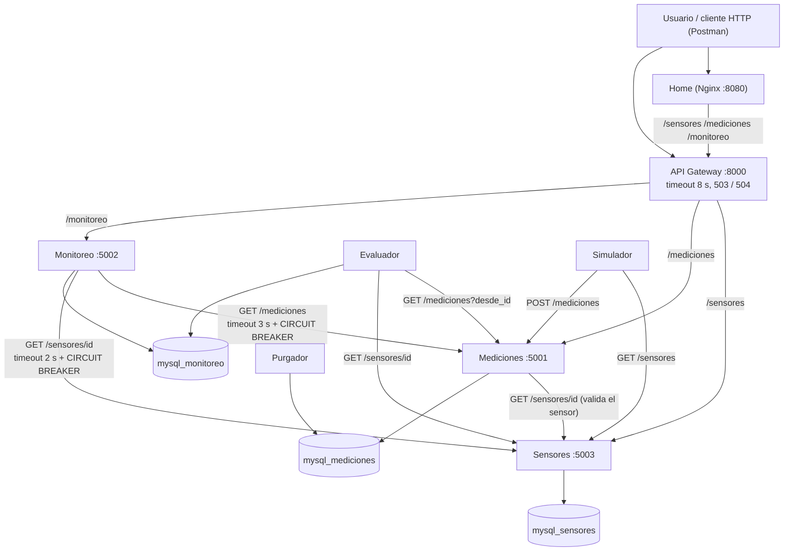

# AgroSense — Sistema Distribuido de Monitoreo IoT (Simulado)

## Problema que resuelve

En zonas rurales o alejadas, con acceso limitado a energía eléctrica e internet, es
difícil realizar un monitoreo constante de variables ambientales como temperatura,
humedad, calidad del agua, estado del suelo y calidad del aire. La falta de datos
digitalizados y actualizados dificulta la toma de decisiones en actividades como la
agricultura, la investigación ambiental y el cuidado de los recursos naturales.

El sistema resuelve esto mediante una red de sensores IoT **simulada** que genera,
transmite y centraliza datos ambientales, facilita su consulta y análisis, y genera
alertas cuando los valores salen de los umbrales configurados.

## Objetivo

Diseñar y materializar, mediante contenedores, una solución distribuida basada en
microservicios que reciba, almacene y analice mediciones de sensores simulados, con una
vista Home como punto de entrada del usuario.

## Integrantes y roles

| Integrante | Rol principal |
|---|---|
| Nicolas Gaviria | Arquitectura, Docker Compose e integración |
| Jainer Chocue | Servicios Mediciones y Monitoreo (APIs REST) |
| Sebastián Paja | Dockerfiles y contenerización de los servicios |
| Freyder Pacho | Vista Home y documentación |

## Arquitectura

Arquitectura de **microservicios** con estilo cliente–servidor. Cada servicio con
persistencia tiene su **propia base MySQL**; los servicios se comunican por
**HTTP/REST con JSON** dentro de la red `red_iot` de Docker Compose. El usuario entra
por **Home** (Nginx), que sirve la interfaz; todas las peticiones de datos pasan por el
**API Gateway**, que es el único punto de entrada hacia Sensores, Mediciones y Monitoreo.
Solo se publican dos puertos: Home (`8080`) y el Gateway (`8000`).



Detalle completo, inventario de servicios y decisiones de diseño en
[docs/arquitectura/ARCHITECTURE.md](docs/arquitectura/ARCHITECTURE.md).

## Servicios

| Servicio | Responsabilidad | Puerto | Se comunica con | Documentación |
|---|---|---|---|---|
| **API Gateway** | Punto de entrada único: enruta `/sensores`, `/mediciones` y `/monitoreo`, conserva códigos de estado, responde 503/504 y pide credenciales para escribir | `8000` | Sensores, Mediciones, Monitoreo | [servicio-gateway](docs/servicios/servicio-gateway.md) |
| **Home** | Interfaz web (Nginx); reenvía todas las rutas de datos al Gateway | `8080` | Gateway | [servicio-4-home](docs/servicios/servicio-4-home.md) |
| **Mediciones** | Registrar y consultar lecturas | `5001` | Sensores (validación), MySQL propio | [servicio-1-mediciones](docs/servicios/servicio-1-mediciones.md) |
| **Monitoreo** | Resúmenes, umbrales y alertas; protege sus llamadas con timeout y Circuit Breaker | `5002` | Mediciones, Sensores, MySQL propio | [servicio-2-monitoreo](docs/servicios/servicio-2-monitoreo.md) |
| **Sensores** | Catálogo de sensores | `5003` | MySQL propio | [servicio-sensores](docs/servicios/servicio-sensores.md) |
| **Purgador** | Borrar cada hora las lecturas más antiguas que `RETENCION_DIAS` (sin API) | — | MySQL de Mediciones | [servicio-1-mediciones](docs/servicios/servicio-1-mediciones.md) |
| **Evaluador** | Evaluar automáticamente las lecturas nuevas y registrar alertas (mismo código que Monitoreo, sin API) | — | Mediciones, Sensores, MySQL de Monitoreo | [servicio-2-monitoreo](docs/servicios/servicio-2-monitoreo.md) |
| **Simulador** | Generar lecturas y enviarlas a Mediciones (sin API) | — | Sensores, Mediciones | [servicio-3-simulador](docs/servicios/servicio-3-simulador.md) |

## Endpoints

Las rutas son las mismas directamente en cada servicio y a través del Gateway (`:8000`). Los ejemplos
completos para Postman están en [docs/endpoints/](docs/endpoints/).

### Mediciones (`:5001`)

| Método | Ruta | Descripción |
|---|---|---|
| GET | `/health` | Estado del servicio y de la BD |
| POST | `/mediciones` | Registrar una medición (`timestamp` ISO 8601 opcional; rechaza sensores que no estén en el catálogo) |
| GET | `/mediciones` | Las N más recientes (por defecto 100, máx. 1000; la cabecera `X-Limite` indica el límite aplicado). Filtros `sensor_id`, `id`, `limit`, `desde_id` |
| GET | `/mediciones/estadisticas` | Total, sensores con lecturas y promedio por unidad (SQL). Filtro `sensor_id` (añade `promedio` del sensor) |
| GET | `/mediciones/<id>` | Obtener una medición |
| GET | `/mediciones/sensor/<sensor_id>` | Últimas mediciones de un sensor (acepta `limit`) |
| PUT / PATCH | `/mediciones/<id>` | Reemplazar / actualizar parcialmente |
| DELETE | `/mediciones/<id>` | Eliminar |

### Sensores (`:5003`)

| Método | Ruta | Descripción |
|---|---|---|
| GET | `/health` | Estado del servicio y de la BD |
| GET | `/sensores` | Listar (filtros `tipo`, `activo`) |
| GET | `/sensores/<id>` | Obtener un sensor |
| POST | `/sensores` | Crear |
| PUT | `/sensores/<id>` | Reemplazar |
| DELETE | `/sensores/<id>` | Eliminar |

### Monitoreo (`:5002`)

| Método | Ruta | Descripción |
|---|---|---|
| GET | `/health` | Estado del servicio y de la BD |
| GET | `/monitoreo/<sensor_id>` | Resumen del sensor (`404` si no hay lecturas) |
| GET | `/monitoreo/resumen-general` | Métricas globales (total, sensores y promedio por unidad) |
| GET / POST | `/monitoreo/evaluar/<sensor_id>` | Evalúa la última lectura contra su umbral. `GET` solo consulta; `POST` además registra la alerta |
| GET / POST | `/monitoreo/umbrales` | Listar / crear umbrales |
| GET / PUT / DELETE | `/monitoreo/umbrales/<id>` | Obtener / reemplazar / eliminar un umbral |
| GET | `/monitoreo/alertas` | Listar alertas (filtros `sensor_id`, `limit`) |
| GET | `/monitoreo/alertas/<id>` | Obtener una alerta (`404` si no existe) |
| DELETE | `/monitoreo/alertas/<id>` | Eliminar una alerta |
| GET | `/monitoreo/circuitos` | Estado de los Circuit Breakers (`CLOSED` / `OPEN` / `HALF_OPEN`), contador de fallos y configuración |

## Bases de datos

Tres instancias MySQL 8.4 independientes, cada una con su volumen. MySQL crea en cada
una la base del servicio y un usuario (`DB_USER`) con permisos **solo sobre esa base**; los
servicios no usan `root`. Los servicios crean sus tablas al arrancar. Scripts de
referencia en [bases_datos/](bases_datos/).

| Servicio | Contenedor | Base | Tablas |
|---|---|---|---|
| Mediciones | `mysql_mediciones` | `mediciones` | `mediciones` |
| Sensores | `mysql_sensores` | `sensores` | `sensores` |
| Monitoreo | `mysql_monitoreo` | `monitoreo` | `umbrales`, `alertas` |

## Variables de entorno

Se definen en `.env` (copiar de [.env.example](.env.example)). **`.env` es obligatorio**:
Compose se detiene con un mensaje claro si faltan `MYSQL_ROOT_PASSWORD`, `DB_USER`, `DB_PASSWORD`,
`HOME_ADMIN_USER` o `HOME_ADMIN_PASSWORD`.

| Variable | Uso | Por defecto |
|---|---|---|
| `MYSQL_ROOT_PASSWORD` | Contraseña root de los tres MySQL (solo la usa MySQL) | obligatoria |
| `DB_USER` | Usuario de los servicios (no puede ser `root`) | obligatoria |
| `DB_PASSWORD` | Contraseña de ese usuario | obligatoria |
| `HOME_ADMIN_USER` | Usuario que Nginx exige para crear, modificar y borrar datos | obligatoria |
| `HOME_ADMIN_PASSWORD` | Contraseña de ese usuario | obligatoria |
| `RETENCION_DIAS` | Días que se conservan lecturas y alertas (`0` = no borrar nada) | `30` |
| `INTERVALO_SEGUNDOS` | Segundos entre envíos del Simulador | `5` |
| `INTERVALO_EVALUACION_SEGUNDOS` | Segundos entre ciclos del Evaluador | `10` |
| `MEDICIONES_TIMEOUT` | Timeout (s) de Monitoreo hacia Mediciones | `3` |
| `SENSORES_TIMEOUT` | Timeout (s) de Monitoreo hacia Sensores | `2` |
| `GATEWAY_TIMEOUT` | Timeout (s) del Gateway hacia cualquier servicio | `8` |
| `CB_MAX_FAILS` | Fallas técnicas seguidas que abren el Circuit Breaker | `3` |
| `CB_TIMEOUT` | Segundos en `OPEN` antes de la solicitud de prueba (`HALF_OPEN`) | `10` |
| `DELAY_SEGUNDOS` | Demora inicial simulada de Mediciones (pruebas de Timeout) | `0` |

Compose fija además, por servicio: `DB_HOST` (`mysql_mediciones`, `mysql_sensores`,
`mysql_monitoreo`), `DB_NAME` (`mediciones`, `sensores`, `monitoreo`),
`MEDICIONES_URL=http://mediciones:5001` y `SENSORES_URL=http://sensores:5003`; el Gateway recibe
`SENSOR_SERVICE_URL`, `MEDICIONES_SERVICE_URL` y `MONITOREO_SERVICE_URL`. `HOME_ADMIN_USER` y
`HOME_ADMIN_PASSWORD` también protegen la escritura en el Gateway.

## Cómo ejecutar

Requisitos: Docker y Docker Compose.

```bash
cp .env.example .env
docker compose up --build
```

Se publican solo **Home** (<http://localhost:8080>) y el **API Gateway** (<http://localhost:8000>).
Los microservicios y las bases de datos quedan en la red interna `red_iot`: no necesitan puerto público
porque solo los consumen el Gateway y los demás servicios, que los resuelven por nombre de servicio
(`http://mediciones:5001`, ...). Menos puertos publicados es menos superficie de ataque, y todo el
tráfico externo pasa por un único punto donde se aplican las credenciales, el timeout y el manejo de errores.

```bash
docker compose up -d --build
docker compose ps
curl localhost:8000/health        # estado del Gateway y de cada servicio
```

### Quién puede escribir

Consultar es libre. **Crear, modificar y borrar** (`POST`, `PUT`, `PATCH` y `DELETE` sobre `/sensores`,
`/mediciones` y `/monitoreo`, por Home o por el Gateway) exige el usuario y la contraseña de `HOME_ADMIN_USER` / `HOME_ADMIN_PASSWORD`: el navegador
muestra el diálogo de acceso la primera vez que se intenta escribir desde la pantalla de administración. Sin
credenciales (o con unas incorrectas) Nginx o el Gateway responden `401`. Evaluar un sensor
(`POST /monitoreo/evaluar/<id>`) no las pide: es idempotente y solo deriva datos que ya existen.

```bash
curl -u admin:cambiar-admin -X POST localhost:8000/mediciones \
  -H 'Content-Type: application/json' -d '{"sensor_id": 1, "valor": 21.5, "unidad": "C"}'
```

> **Límites:** la autenticación es de tipo Basic sobre HTTP, así que usuario y contraseña viajan sin cifrar:
> es adecuada en local o para una demostración; para exponer el sistema hace falta HTTPS. Hay una sola cuenta
> (sin usuarios ni roles). Los puertos de `compose.dev.yaml` publican las APIs **sin** esta protección: solo
> para desarrollo.

Para desarrollo, publica también los puertos de cada API (saltándose el Gateway):

```bash
docker compose -f compose.yaml -f compose.dev.yaml up --build
```

- Mediciones: <http://localhost:5001>
- Monitoreo: <http://localhost:5002>
- Sensores: <http://localhost:5003>

Pruebas rápidas (con el archivo de desarrollo):

```bash
curl localhost:5001/health localhost:5002/health localhost:5003/health
curl localhost:5003/sensores
curl localhost:5001/mediciones
curl -X POST localhost:5002/monitoreo/evaluar/1
```

### Cambiar credenciales

`MYSQL_USER` y `MYSQL_PASSWORD` solo se aplican cuando el volumen de MySQL está vacío. Si ya
levantaste el sistema antes (por ejemplo con `root`/`root`), debes recrear los volúmenes
con `docker compose down -v`, lo que **borra los datos**. Lo mismo ocurre con el cambio de
`timestamp` de texto a `DATETIME(3)`: las tablas existentes no se migran.

MySQL 8.4 sustituye a 8.0 (que dejó de recibir soporte). Un volumen de 8.0 se puede actualizar
en sitio, pero conviene hacer una copia antes.

Apagar (con `-v` también borra los datos de las bases):

```bash
docker compose down
docker compose down -v
```

## API Gateway

Servicio `gateway/` (Flask + gunicorn, puerto `8000`). No contiene lógica de negocio ni acceso a bases de
datos: identifica el servicio por el primer segmento de la ruta y reenvía método, parámetros, cuerpo y la
respuesta con su código de estado.

| Ruta pública | Servicio destino | Métodos |
|---|---|---|
| `/sensores`, `/sensores/<id>` | Sensores (`sensores:5003`) | GET, POST, PUT, DELETE |
| `/mediciones`, `/mediciones/<id>`, `/mediciones/sensor/<id>`, `/mediciones/estadisticas` | Mediciones (`mediciones:5001`) | GET, POST, PUT, PATCH, DELETE |
| `/monitoreo/umbrales[/<id>]`, `/monitoreo/alertas[/<id>]`, `/monitoreo/resumen-general`, `/monitoreo/evaluar/<id>`, `/monitoreo/circuitos`, `/monitoreo/<id>` | Monitoreo (`monitoreo:5002`) | según la ruta |
| `/health` | Gateway (consulta `/health` de cada servicio) | GET |

Errores del Gateway: `404` ruta desconocida, `401` escritura sin credenciales, `503` servicio caído,
`504` servicio que no responde dentro de `GATEWAY_TIMEOUT`.

## Comunicación entre servicios

Dentro de `red_iot` cada servicio se llama por el nombre que le da Compose (DNS interno de Docker).

| Solicitante | Destino | Endpoint | Método | Información |
|---|---|---|---|---|
| Home (Nginx) | Gateway | `/sensores`, `/mediciones`, `/monitoreo` | todos | Peticiones de la interfaz |
| Gateway | Sensores / Mediciones / Monitoreo | rutas públicas | todos | Reenvío de la petición y de la respuesta |
| Monitoreo | Mediciones | `/mediciones`, `/mediciones/estadisticas` | GET | Lecturas y estadísticas para resúmenes y evaluación |
| Monitoreo | Sensores | `/sensores/<id>` | GET | Tipo del sensor para elegir el umbral |
| Mediciones | Sensores | `/sensores/<id>` | GET | Validar que el sensor existe antes de registrar |
| Evaluador | Mediciones | `/mediciones?desde_id=` | GET | Lecturas nuevas a evaluar |
| Simulador | Sensores / Mediciones | `/sensores`, `/mediciones` | GET / POST | Catálogo y envío de lecturas |

Ningún servicio consulta la base de datos de otro.

## Timeout y Circuit Breaker

**Dependencia protegida:** Monitoreo → Mediciones (y, con el mismo patrón, Monitoreo → Sensores).
Código en [monitoreo/app.py](monitoreo/app.py) (`consultar_mediciones`, `tipo_de_sensor`, `crear_circuito`).

| Parámetro | Valor |
|---|---|
| Servicio que realiza la solicitud | Monitoreo |
| Servicio protegido | Mediciones (y Sensores) |
| Timeout configurado | `MEDICIONES_TIMEOUT=3` s (Sensores: `SENSORES_TIMEOUT=2` s) |
| Umbral de fallas | `CB_MAX_FAILS=3` fallas seguidas |
| Tiempo de recuperación | `CB_TIMEOUT=10` s |

Comportamiento de `consultar_mediciones` (librería `pybreaker`):

| Situación en Mediciones | Respuesta de Monitoreo | ¿Cuenta como falla? |
|---|---|---|
| Timeout agotado | `504` | Sí |
| Sin conexión (servicio caído) | `503` | Sí |
| HTTP 5xx | `502` | Sí |
| Circuito `OPEN` | `503` sin llamar a Mediciones | — |
| 404 / 400 (error del cliente) | se informa tal cual | No |

Estados: **CLOSED** (deja pasar y cuenta fallas) → tras 3 fallas **OPEN** (rechaza sin llamar) → pasados
10 s **HALF_OPEN** (la siguiente solicitud es la prueba) → si funciona **CLOSED**, si falla vuelve a **OPEN**.
`GET /monitoreo/circuitos` muestra el estado y el contador. Monitoreo corre con un solo proceso de gunicorn
(8 hilos) para que el estado del circuito sea único. Si Sensores falla, la evaluación no se interrumpe: el
tipo se deduce de la unidad de la lectura.

**Simular una respuesta lenta** (Mediciones tarda más que el timeout) y restablecerla:

```bash
curl -u admin:clave -X PUT localhost:8000/mediciones/simulacion/demora -H 'Content-Type: application/json' -d '{"segundos": 6}'
curl localhost:8000/monitoreo/resumen-general      # 504: el servicio de Mediciones no respondió a tiempo
curl -u admin:clave -X PUT localhost:8000/mediciones/simulacion/demora -H 'Content-Type: application/json' -d '{"segundos": 0}'
```

## Persistencia

Cada MySQL guarda sus datos en un volumen con nombre (`mysql_mediciones_data`, `mysql_sensores_data`,
`mysql_monitoreo_data`). Los contenedores de aplicación son desechables: se pueden detener y recrear
(`docker compose rm -sf ...` + `docker compose up -d`) sin perder datos mientras no se use `down -v`.
La prueba está automatizada en [docs/pruebas/](docs/pruebas/).

## Pruebas integrales

La matriz de verificación y las evidencias están en [docs/pruebas/README.md](docs/pruebas/README.md).
El script [docs/pruebas/pruebas-integrales.sh](docs/pruebas/pruebas-integrales.sh) ejecuta, sobre el stack
real y a través del Gateway, el CRUD de cada servicio, los errores, el timeout, el Circuit Breaker, la caída
de un servicio y la persistencia:

```bash
bash docs/pruebas/pruebas-integrales.sh            # todo
bash docs/pruebas/pruebas-integrales.sh circuito   # crud | errores | timeout | circuito | caida | persistencia
```

## Integración continua

El workflow de GitHub Actions, en cada Pull Request hacia `main`:

1. Revisa el código Python con `ruff` (reglas mínimas, ver `ruff.toml`).
2. Ejecuta las pruebas de `gateway`, `mediciones`, `monitoreo`, `sensores` y `simulador` (`pytest`).
3. Ejecuta las pruebas de navegador del Home (`home/e2e`, sin Docker).
4. Levanta el stack completo con `docker compose up --wait` (respeta los healthchecks) y
   ejecuta una prueba de humo contra las APIs y el proxy de Home.

Pruebas en local (no necesitan Docker):

```bash
# APIs (BD simulada)
pip install -r <servicio>/requirements.txt -r requirements-dev.txt
cd <servicio> && python -m pytest

# Home en un navegador real (Node >= 22.12; usa el Chrome instalado, CHROME_PATH para indicar otro)
cd home/e2e && npm install && npm test
```

Las pruebas del Home sirven la interfaz con las mismas cabeceras de seguridad que `nginx.conf`
(las leen de ese archivo) y simulan las APIs, de modo que comprueban también la CSP.

## Estructura del repositorio

```
.
├── home/            # Interfaz (HTML/CSS/JS, Chart.js en vendor/) + nginx.conf + Dockerfile
│   └── e2e/         # Pruebas de navegador del Home (Node + Chrome)
├── gateway/         # API Gateway (Flask): punto de entrada de las APIs
├── mediciones/      # Microservicio Mediciones (Flask)
├── sensores/        # Microservicio Sensores (Flask)
├── monitoreo/       # Microservicio Monitoreo (Flask)
├── simulador/       # Generador de datos simulados
├── bases_datos/     # Scripts SQL de referencia
├── docs/            # Arquitectura, endpoints, pruebas y documentación por servicio
├── compose.yaml             # Stack (publica Home y el Gateway)
├── compose.dev.yaml         # Publica los puertos de las APIs (desarrollo)
├── requirements-dev.txt     # Dependencias de las pruebas
├── ruff.toml                # Configuración del lint
└── .env.example
```

## Estado actual

**Terminado:** los servicios de dominio (Sensores, Mediciones y Monitoreo) con CRUD sobre su propia base MySQL,
el API Gateway, Home integrado con el Gateway, timeouts configurables, Circuit Breaker en Monitoreo,
errores HTTP en JSON (400, 401, 404, 500, 502, 503, 504), healthchecks, persistencia con volúmenes y
pruebas automáticas (pytest, navegador y CI con el stack completo).

**Pendiente / fuera del alcance de esta entrega:**

- Servicio de Notificaciones: no forma parte de la arquitectura entregada; las alertas se consultan en
  Monitoreo (`/monitoreo/alertas`) y se muestran en Home.
- HTTPS, usuarios con roles y despliegue en la nube (hoy hay una sola cuenta de administración).

El estado de la auditoría y lo que requiere supervisión está en [docs/seguimiento-auditoria.md](docs/seguimiento-auditoria.md).
