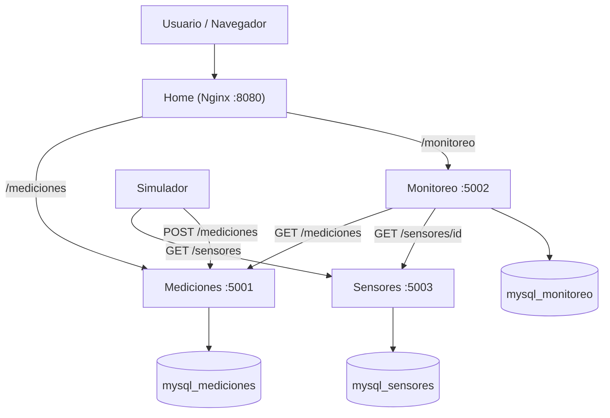

# AgroSense — Sistema Distribuido de Monitoreo IoT (Simulado)

## Problema que resuelve

En zonas rurales o alejadas, con acceso limitado a energía eléctrica e internet, es
difícil realizar un monitoreo constante de variables ambientales como temperatura,
humedad, calidad del agua, estado del suelo y calidad del aire. La falta de datos
digitalizados y actualizados dificulta la toma de decisiones en actividades como la
agricultura, la investigación ambiental y el cuidado de los recursos naturales.

El sistema resuelve esto mediante una red de sensores IoT **simulada** que genera,
transmite y centraliza datos ambientales, facilita su consulta y análisis, y genera
alertas cuando los valores salen de los umbrales configurados.

## Objetivo

Diseñar y materializar, mediante contenedores, una solución distribuida basada en
microservicios que reciba, almacene y analice mediciones de sensores simulados, con una
vista Home como punto de entrada del usuario.

## Integrantes y roles

| Integrante | Rol principal |
|---|---|
| Nicolas Gaviria | Arquitectura, Docker Compose e integración |
| Jainer Chocue | Servicios Mediciones y Monitoreo (APIs REST) |
| Sebastián Paja | Dockerfiles y contenerización de los servicios |
| Freyder Pacho | Vista Home y documentación |

## Arquitectura

Arquitectura de **microservicios** con estilo cliente–servidor. Cada servicio con
persistencia tiene su **propia base MySQL**; los servicios se comunican por
**HTTP/REST con JSON** dentro de la red `red_iot` de Docker Compose. El usuario entra
por Home (Nginx), que sirve la interfaz y actúa como proxy hacia las APIs.



Detalle completo en [docs/arquitectura/ARCHITECTURE.md](docs/arquitectura/ARCHITECTURE.md).

## Servicios

| Servicio | Responsabilidad | Puerto | Se comunica con | Documentación |
|---|---|---|---|---|
| **Home** | Interfaz web (Nginx) y proxy hacia `/mediciones` y `/monitoreo` | `8080` → 80 | Mediciones, Monitoreo | [servicio-4-home](docs/servicios/servicio-4-home.md) |
| **Mediciones** | Registrar y consultar lecturas | `5001` | MySQL propio | [servicio-1-mediciones](docs/servicios/servicio-1-mediciones.md) |
| **Monitoreo** | Resúmenes, umbrales y alertas | `5002` | Mediciones, Sensores, MySQL propio | [servicio-2-monitoreo](docs/servicios/servicio-2-monitoreo.md) |
| **Sensores** | Catálogo de sensores | `5003` | MySQL propio | [servicio-sensores](docs/servicios/servicio-sensores.md) |
| **Simulador** | Generar lecturas y enviarlas a Mediciones (sin API) | — | Sensores, Mediciones | [servicio-3-simulador](docs/servicios/servicio-3-simulador.md) |

## Endpoints

### Mediciones (`:5001`)

| Método | Ruta | Descripción |
|---|---|---|
| GET | `/health` | Estado del servicio y de la BD |
| POST | `/mediciones` | Registrar una medición |
| GET | `/mediciones` | Listar (filtros `sensor_id`, `id`, `limit`) |
| GET | `/mediciones/<id>` | Obtener una medición |
| GET | `/mediciones/sensor/<sensor_id>` | Mediciones de un sensor |
| PUT / PATCH | `/mediciones/<id>` | Reemplazar / actualizar parcialmente |
| DELETE | `/mediciones/<id>` | Eliminar |

### Sensores (`:5003`)

| Método | Ruta | Descripción |
|---|---|---|
| GET | `/health` | Estado del servicio y de la BD |
| GET | `/sensores` | Listar (filtros `tipo`, `activo`) |
| GET | `/sensores/<id>` | Obtener un sensor |
| POST | `/sensores` | Crear |
| PUT | `/sensores/<id>` | Reemplazar |
| DELETE | `/sensores/<id>` | Eliminar |

### Monitoreo (`:5002`)

| Método | Ruta | Descripción |
|---|---|---|
| GET | `/health` | Estado del servicio y de la BD |
| GET | `/monitoreo/<sensor_id>` | Resumen del sensor (`404` si no hay lecturas) |
| GET | `/monitoreo/resumen-general` | Métricas globales |
| GET | `/monitoreo/evaluar/<sensor_id>` | Evalúa la última lectura contra su umbral y registra alerta |
| GET / POST | `/monitoreo/umbrales` | Listar / crear umbrales |
| GET / PUT / DELETE | `/monitoreo/umbrales/<id>` | Obtener / reemplazar / eliminar un umbral |
| GET | `/monitoreo/alertas` | Listar alertas (filtros `sensor_id`, `limit`) |
| DELETE | `/monitoreo/alertas/<id>` | Eliminar una alerta |

## Bases de datos

Tres instancias MySQL 8.0 independientes, cada una con su volumen. Los servicios crean
su base y sus tablas al arrancar (requieren un usuario con `CREATE`; `root` sirve).
Scripts de referencia en [bases_datos/](bases_datos/).

| Servicio | Contenedor | Base | Tablas |
|---|---|---|---|
| Mediciones | `mysql_mediciones` | `mediciones` | `mediciones` |
| Sensores | `mysql_sensores` | `sensores` | `sensores` |
| Monitoreo | `mysql_monitoreo` | `monitoreo` | `umbrales`, `alertas` |

## Variables de entorno

Se definen en `.env` (copiar de [.env.example](.env.example)). Todas tienen valor por
defecto en `docker-compose.yml`, por lo que `.env` es opcional.

| Variable | Uso | Por defecto |
|---|---|---|
| `MYSQL_ROOT_PASSWORD` | Contraseña root de los tres MySQL | `root` |
| `DB_USER` | Usuario con el que los servicios se conectan | `root` |
| `DB_PASSWORD` | Contraseña de ese usuario (igual a `MYSQL_ROOT_PASSWORD` si es `root`) | `root` |
| `DB_PORT` | Puerto de MySQL | `3306` |
| `INTERVALO_SEGUNDOS` | Segundos entre envíos del Simulador | `5` |

Compose fija además, por servicio: `DB_HOST` (`mysql_mediciones`, `mysql_sensores`,
`mysql_monitoreo`), `DB_NAME` (`mediciones`, `sensores`, `monitoreo`),
`MEDICIONES_URL=http://mediciones:5001` y `SENSORES_URL=http://sensores:5003`.

## Cómo ejecutar

Requisitos: Docker y Docker Compose.

```bash
cp .env.example .env
docker compose up --build
```

Servicios expuestos:

- Home: <http://localhost:8080>
- Mediciones: <http://localhost:5001>
- Monitoreo: <http://localhost:5002>
- Sensores: <http://localhost:5003>

Pruebas rápidas:

```bash
curl localhost:5001/health localhost:5002/health localhost:5003/health
curl localhost:5003/sensores
curl localhost:5001/mediciones
curl localhost:5002/monitoreo/evaluar/1
```

Apagar (con `-v` también borra los datos de las bases):

```bash
docker compose down
docker compose down -v
```

## Integración continua

El workflow de GitHub Actions valida `docker-compose.yml` (`docker compose config -q`)
en cada Pull Request hacia `main`.

## Estructura del repositorio

```
.
├── home/            # Interfaz (HTML/CSS/JS) + nginx.conf + Dockerfile
├── mediciones/      # Microservicio Mediciones (Flask)
├── sensores/        # Microservicio Sensores (Flask)
├── monitoreo/       # Microservicio Monitoreo (Flask)
├── simulador/       # Generador de datos simulados
├── bases_datos/     # Scripts SQL de referencia
├── docs/            # Arquitectura y documentación por servicio
├── docker-compose.yml
└── .env.example
```

## Pendiente

- Servicio de Notificaciones que consuma las alertas.
- Autenticación, seguridad y despliegue en la nube.
