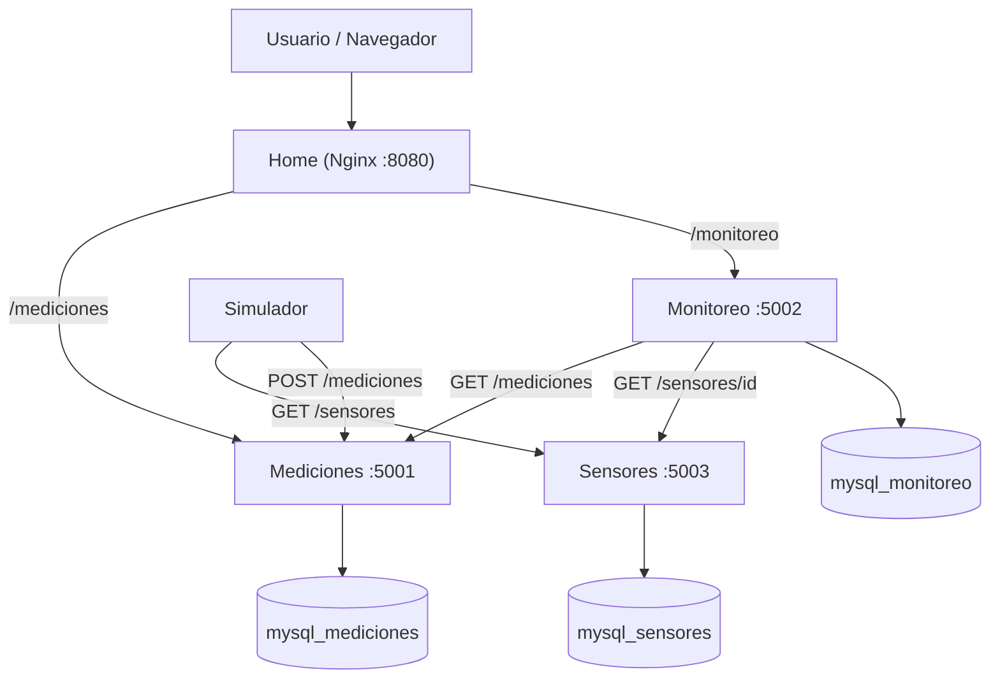

# Arquitectura — Sistema Distribuido de Monitoreo IoT (Simulado)

## 1. Descripción general

El sistema monitorea sensores (temperatura y humedad) cuyos datos genera un simulador,
ya que no se cuenta con hardware físico. Sigue una arquitectura de **microservicios**:
cada responsabilidad (catálogo de sensores, almacenamiento de mediciones, umbrales y
alertas) vive en un servicio independiente, con su propia base de datos MySQL, y se
comunica con los demás por **HTTP/REST con JSON**. La vista Home es el punto de entrada
del usuario y actúa como proxy hacia las APIs mediante Nginx.

## 2. Diagrama de arquitectura

## 3. Componentes

| Componente | Tipo | Puerto | Base de datos |
|---|---|---|---|
| Home | Frontend estático + proxy (Nginx) | 8080 → 80 | — |
| Mediciones | Microservicio Flask | 5001 | `mediciones` (en `mysql_mediciones`) |
| Sensores | Microservicio Flask | 5003 | `sensores` (en `mysql_sensores`) |
| Monitoreo | Microservicio Flask | 5002 | `monitoreo` (en `mysql_monitoreo`) |
| Simulador | Proceso generador de datos | — | — |

Todos los contenedores comparten la red `red_iot` de Docker Compose y se resuelven por
nombre de servicio.

## 4. Responsabilidades

| Servicio | Responsabilidad | Información que maneja |
|---|---|---|
| Home | Presentar el dashboard y redirigir `/mediciones` y `/monitoreo` a sus APIs | HTML, CSS, JS |
| Mediciones | Registrar, consultar, modificar y borrar lecturas | `sensor_id`, `valor`, `unidad`, `timestamp` |
| Sensores | Catálogo de sensores (alta, baja, estado activo) | `nombre`, `tipo`, `ubicacion`, `activo` |
| Monitoreo | Resúmenes, umbrales por tipo y alertas | `umbrales`, `alertas` |
| Simulador | Generar lecturas de los sensores activos y enviarlas | — |

## 5. Comunicación entre servicios

| Solicita | Responde | Endpoint | Enviado | Recibido |
|---|---|---|---|---|
| Simulador | Mediciones | `GET /health` | — | `{"status":"ok"}` |
| Simulador | Sensores | `GET /sensores?activo=true` | filtro `activo` | Lista de sensores activos |
| Simulador | Mediciones | `POST /mediciones` | `sensor_id`, `valor`, `unidad` | `201` con la medición creada |
| Monitoreo | Mediciones | `GET /mediciones?sensor_id=X&limit=N` | `sensor_id`, `limit` opcionales | Lista de mediciones en orden cronológico |
| Monitoreo | Sensores | `GET /sensores/<id>` | `id` del sensor | Sensor con su `tipo` (si falla, el tipo se deduce de la unidad) |
| Home (vía Nginx) | Mediciones | `/mediciones/...` | Petición del navegador | Respuesta JSON de la API |
| Home (vía Nginx) | Monitoreo | `/monitoreo/...` | Petición del navegador | Respuesta JSON de la API |

## 6. Decisiones de diseño

- **Una base MySQL por servicio**: cada servicio es dueño de sus datos; ninguno accede
  a la base de otro, solo a su API.
- **Autoinicialización**: cada servicio crea su base y sus tablas al arrancar y
  reintenta mientras MySQL queda disponible. Compose además espera el healthcheck de
  cada MySQL (`depends_on: condition: service_healthy`).
- **Servicio Sensores independiente**: el catálogo ya no es una lista fija del
  Simulador. El Simulador y Monitoreo lo consultan; el Simulador conserva un catálogo
  de respaldo si Sensores no responde.
- **Home como proxy**: Nginx sirve la interfaz y reenvía `/mediciones` y `/monitoreo`,
  evitando problemas de CORS y puertos desde el navegador.

## 7. Cambios de contrato respecto a versiones anteriores

- `GET /mediciones/sensor/<sensor_id>` reemplaza a `GET /mediciones/<sensor_id>`;
  ahora `GET /mediciones/<int:id>` devuelve una medición por su identificador.
- `GET /monitoreo/<sensor_id>` devuelve `404` cuando el sensor no tiene lecturas.

## 8. Pendiente

- Servicio de Notificaciones que consuma las alertas.
- Autenticación y seguridad.
- Despliegue en la nube.
