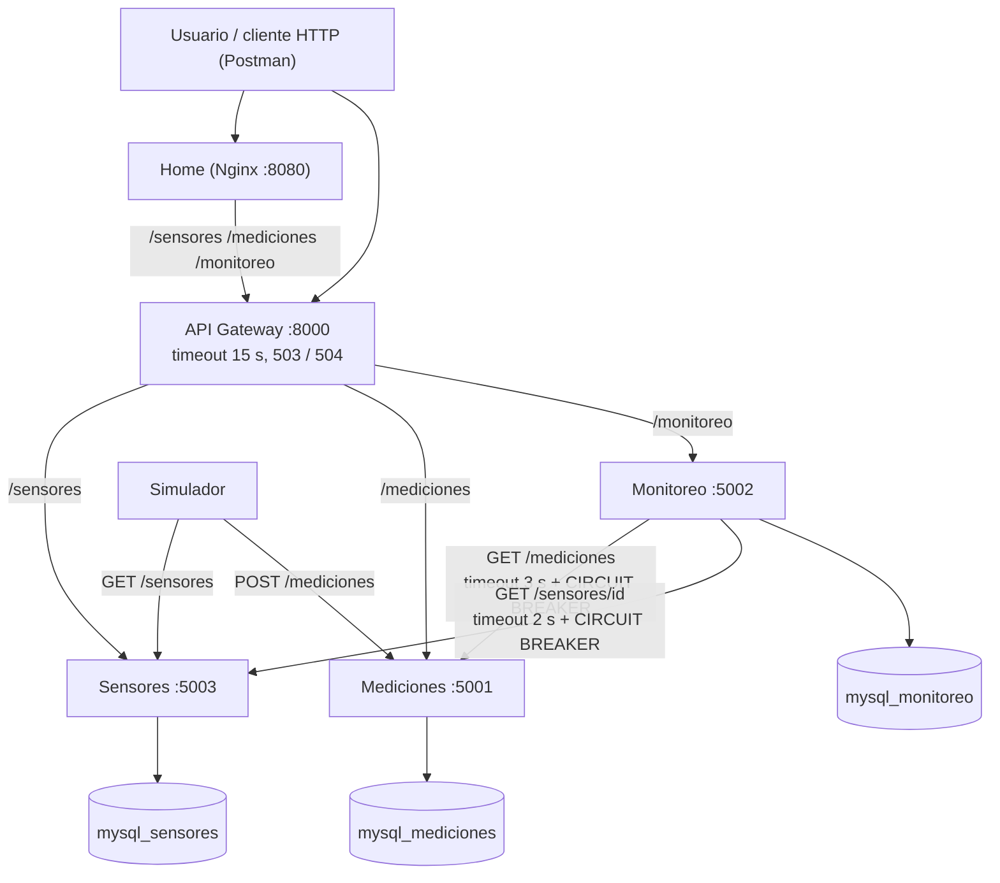

# Arquitectura — Sistema Distribuido de Monitoreo IoT (Simulado)

## 1. Descripción general

El sistema monitorea sensores (temperatura y humedad) cuyos datos genera un simulador,
ya que no se cuenta con hardware físico. Sigue una arquitectura de **microservicios**:
cada responsabilidad (catálogo de sensores, almacenamiento de mediciones, umbrales y
alertas) vive en un servicio independiente, con su propia base de datos MySQL, y se
comunica con los demás por **HTTP/REST con JSON**. La vista Home es el punto de entrada
del usuario; todas las peticiones de datos pasan por el **API Gateway**, que las enruta al microservicio
correspondiente. Las llamadas de Monitoreo a otros servicios tienen **timeout y Circuit Breaker**.

## 2. Diagrama de arquitectura

## 3. Componentes

| Componente | Tipo | Puerto | Base de datos |
|---|---|---|---|
| API Gateway | Servicio Flask + gunicorn: enruta a Sensores, Mediciones y Monitoreo | 8000 | — |
| Home | Frontend estático (Nginx); reenvía las rutas de datos al Gateway | 8080 → 80 | — |
| Mediciones | Microservicio Flask | 5001 | `mediciones` (en `mysql_mediciones`) |
| Sensores | Microservicio Flask | 5003 | `sensores` (en `mysql_sensores`) |
| Monitoreo | Microservicio Flask | 5002 | `monitoreo` (en `mysql_monitoreo`) |
| Simulador | Proceso generador de datos | — | — |

Todos los contenedores comparten la red `red_iot` de Docker Compose y se resuelven por
nombre de servicio. Solo Home (8080) y el Gateway (8000) se publican en el host; las APIs y las bases
quedan en la red interna (`docker-compose.dev.yml` publica los puertos de las APIs para desarrollo).

### Inventario de servicios

| Microservicio | Responsabilidad | Base de datos | Comunicación con otros servicios | Estado |
|---|---|---|---|---|
| Sensores | Catálogo de sensores (CRUD) | `sensores` | Ninguna (lo consultan los demás) | Implementado |
| Mediciones | Lecturas de sensores (CRUD) | `mediciones` | Ninguna | Implementado |
| Monitoreo | Umbrales (CRUD), alertas, resúmenes y evaluación | `monitoreo` | Mediciones y Sensores (con timeout y Circuit Breaker) | Implementado |
| API Gateway | Punto de entrada único hacia las APIs | — | Sensores, Mediciones, Monitoreo | Implementado |
| Home | Interfaz web | — | Gateway | Implementado |
| Simulador | Genera lecturas simuladas | — | Sensores, Mediciones | Implementado |
| Notificaciones | Enviar avisos con las alertas | — | — | **Fuera de alcance** (no forma parte de esta entrega) |

## 4. Responsabilidades

| Servicio | Responsabilidad | Información que maneja |
|---|---|---|
| API Gateway | Punto de entrada único: identifica el servicio por la ruta, reenvía método, cuerpo y código de estado, y traduce fallos de comunicación (503/504) | Ninguno (sin lógica de negocio ni BD) |
| Home | Presentar el dashboard; sus peticiones de datos van al Gateway | HTML, CSS, JS |
| Mediciones | Registrar, consultar, modificar y borrar lecturas | `sensor_id`, `valor`, `unidad`, `timestamp` |
| Sensores | Catálogo de sensores (alta, baja, estado activo) | `nombre`, `tipo`, `ubicacion`, `activo` |
| Monitoreo | Resúmenes, umbrales por tipo y alertas | `umbrales`, `alertas` |
| Simulador | Generar lecturas de los sensores activos y enviarlas | — |

## 5. Comunicación entre servicios

| Solicita | Responde | Endpoint | Enviado | Recibido |
|---|---|---|---|---|
| Simulador | Mediciones | `GET /health` | — | `{"status":"ok"}` |
| Simulador | Sensores | `GET /sensores?activo=true` | filtro `activo` | Lista de sensores activos |
| Simulador | Mediciones | `POST /mediciones` | `sensor_id`, `valor`, `unidad` | `201` con la medición creada |
| Monitoreo | Mediciones | `GET /mediciones?sensor_id=X&limit=N` | `sensor_id`, `limit` opcionales | Lista de mediciones en orden cronológico |
| Monitoreo | Sensores | `GET /sensores/<id>` | `id` del sensor | Sensor con su `tipo` (si falla, el tipo se deduce de la unidad) |
| Home (vía Nginx) | Mediciones | `/mediciones/...` | Petición del navegador | Respuesta JSON de la API |
| Home (vía Nginx) | Monitoreo | `/monitoreo/...` | Petición del navegador | Respuesta JSON de la API |

### Ubicación de Timeout y Circuit Breaker

| Dependencia | Timeout | Circuit Breaker | Si falla |
|---|---|---|---|
| Gateway → cualquier servicio | `GATEWAY_TIMEOUT` = 15 s | No | `504` (timeout) o `503` (caído) |
| Monitoreo → Mediciones | `MEDICIONES_TIMEOUT` = 3 s | Sí (3 fallas, recuperación 10 s) | `504`, `503` o `502` |
| Monitoreo → Sensores | `SENSORES_TIMEOUT` = 2 s | Sí (3 fallas, recuperación 10 s) | La evaluación continúa deduciendo el tipo de la unidad |
| Simulador → Mediciones / Sensores | `MEDICIONES_TIMEOUT` / `SENSORES_TIMEOUT` | Sí | Omite el envío o usa el catálogo de respaldo |

El timeout del Gateway es mayor que los de Monitoreo para que sea Monitoreo quien responda su propio `504`
y el Gateway lo reenvíe sin cambiarlo. Detalle y pruebas en el [README](../../README.md#timeout-y-circuit-breaker)
y en [docs/pruebas](../pruebas/README.md).

## 6. Decisiones de diseño

- **Una base MySQL por servicio**: cada servicio es dueño de sus datos; ninguno accede
  a la base de otro, solo a su API.
- **Autoinicialización**: cada servicio crea su base y sus tablas al arrancar y
  reintenta mientras MySQL queda disponible. Compose además espera el healthcheck de
  cada MySQL (`depends_on: condition: service_healthy`).
- **Servicio Sensores independiente**: el catálogo ya no es una lista fija del
  Simulador. El Simulador y Monitoreo lo consultan; el Simulador conserva un catálogo
  de respaldo si Sensores no responde.
- **Home como proxy hacia el Gateway**: Nginx sirve la interfaz y reenvía `/sensores`, `/mediciones` y
  `/monitoreo` al Gateway, evitando problemas de CORS y puertos desde el navegador.
- **API Gateway como único punto de entrada**: Home y los clientes HTTP entran por él. Solo enruta: no repite
  SQL ni lógica de negocio. El resto de servicios no se publican en el host.
- **Circuit Breaker con `pybreaker`**: el estado vive en memoria del proceso de Monitoreo (un solo proceso).
  `GET /monitoreo/circuitos` informa HALF_OPEN en cuanto vence el tiempo de recuperación, aunque la librería
  solo cambie de estado al recibir la siguiente solicitud.
- **Solo las fallas técnicas abren el circuito** (timeout, conexión, 5xx); un 404 de la dependencia es una
  respuesta válida y no cuenta.
- **Demora simulada en Mediciones** (`PUT /mediciones/simulacion/demora`) para demostrar el Timeout sin
  modificar código; se restablece con `0`.

## 7. Cambios de contrato respecto a versiones anteriores

- `GET /mediciones/sensor/<sensor_id>` reemplaza a `GET /mediciones/<sensor_id>`;
  ahora `GET /mediciones/<int:id>` devuelve una medición por su identificador.
- `GET /monitoreo/<sensor_id>` devuelve `404` cuando el sensor no tiene lecturas.

## 8. Pendiente

- Notificaciones: fuera del alcance de esta entrega; las alertas se consultan en Monitoreo.
- Autenticación, seguridad y despliegue en la nube.
