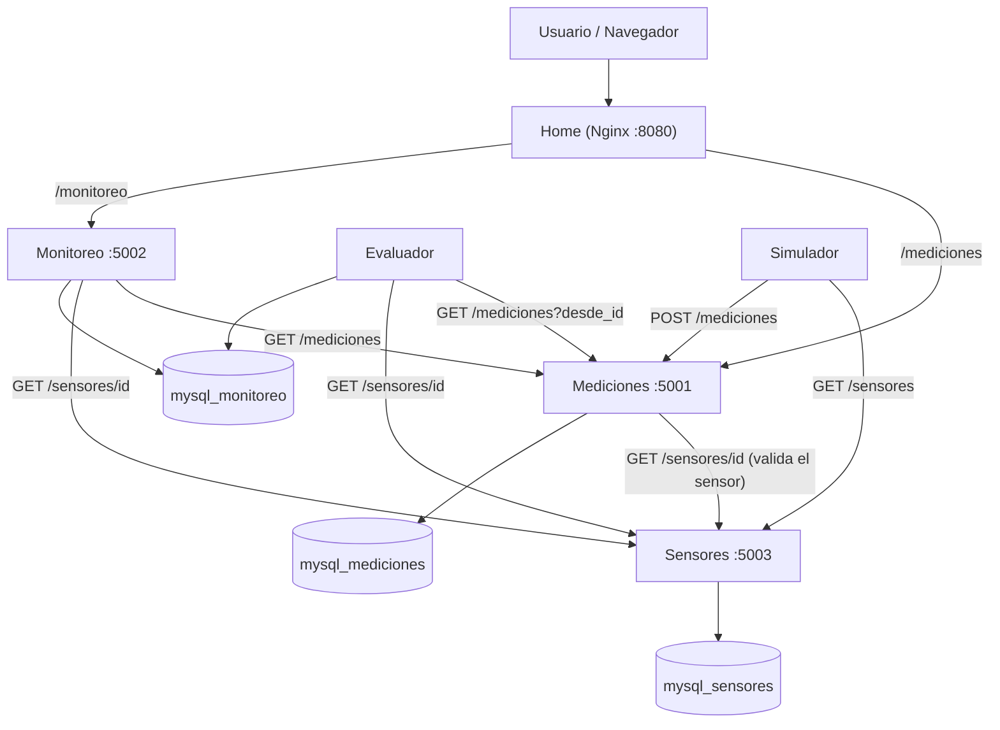

# Arquitectura — Sistema Distribuido de Monitoreo IoT (Simulado)

## 1. Descripción general

El sistema monitorea sensores (temperatura y humedad) cuyos datos genera un simulador,
ya que no se cuenta con hardware físico. Sigue una arquitectura de **microservicios**:
cada responsabilidad (catálogo de sensores, almacenamiento de mediciones, umbrales y
alertas) vive en un servicio independiente, con su propia base de datos MySQL, y se
comunica con los demás por **HTTP/REST con JSON**. La vista Home es el punto de entrada
del usuario y actúa como proxy hacia las APIs mediante Nginx.

## 2. Diagrama de arquitectura

## 3. Componentes

| Componente | Tipo | Puerto | Base de datos |
|---|---|---|---|
| Home | Frontend estático + proxy (Nginx sin privilegios) | 8080 → 8080 | — |
| Mediciones | Microservicio Flask | 5001 | `mediciones` (en `mysql_mediciones`) |
| Sensores | Microservicio Flask | 5003 | `sensores` (en `mysql_sensores`) |
| Monitoreo | Microservicio Flask | 5002 | `monitoreo` (en `mysql_monitoreo`) |
| Evaluador | Worker (imagen de Monitoreo) que evalúa lecturas nuevas y registra alertas | — | `monitoreo` (en `mysql_monitoreo`) |
| Simulador | Proceso generador de datos | — | — |

Todos los contenedores comparten la red por defecto de Docker Compose y se resuelven por
nombre de servicio. Solo Home (8080) se publica en el host; las APIs y las bases quedan en
la red interna (`compose.dev.yaml` publica los puertos de las APIs para desarrollo).

## 4. Responsabilidades

| Servicio | Responsabilidad | Información que maneja |
|---|---|---|
| Home | Presentar el dashboard y redirigir `/mediciones` y `/monitoreo` a sus APIs | HTML, CSS, JS |
| Mediciones | Registrar, consultar, modificar y borrar lecturas | `sensor_id`, `valor`, `unidad`, `timestamp` |
| Sensores | Catálogo de sensores (alta, baja, estado activo) | `nombre`, `tipo`, `ubicacion`, `activo` |
| Monitoreo | Resúmenes, umbrales por tipo y alertas | `umbrales`, `alertas` |
| Evaluador | Evaluar automáticamente las lecturas nuevas contra los umbrales y registrar alertas | `alertas` |
| Simulador | Generar lecturas de los sensores activos y enviarlas | — |

## 5. Comunicación entre servicios

| Solicita | Responde | Endpoint | Enviado | Recibido |
|---|---|---|---|---|
| Simulador | Mediciones | `GET /health` | — | `{"status":"ok"}` |
| Simulador | Sensores | `GET /sensores?activo=true` | filtro `activo` | Lista de sensores activos |
| Simulador | Mediciones | `POST /mediciones` | `sensor_id`, `valor`, `unidad` | `201` con la medición creada |
| Monitoreo | Mediciones | `GET /mediciones?sensor_id=X&limit=N` | `sensor_id`, `limit` opcionales | Lista de mediciones en orden cronológico |
| Monitoreo | Sensores | `GET /sensores/<id>` | `id` del sensor | Sensor con su `tipo` (si falla, el tipo se deduce de la unidad) |
| Mediciones | Sensores | `GET /sensores/<id>` | `id` del sensor | `200`/`404` (si Sensores no responde, la lectura se acepta) |
| Home (vía Nginx) | Mediciones | `/mediciones/...` | Petición del navegador | Respuesta JSON de la API |
| Home (vía Nginx) | Monitoreo | `/monitoreo/...` | Petición del navegador | Respuesta JSON de la API |

## 6. Decisiones de diseño

- **Una base MySQL por servicio**: cada servicio es dueño de sus datos; ninguno accede
  a la base de otro, solo a su API.
- **Autoinicialización**: cada servicio crea sus tablas al arrancar (gunicorn lo hace una
  sola vez, en `on_starting`) y reintenta mientras MySQL queda disponible. Si no lo logra,
  el proceso termina con error y Docker lo reinicia. Compose espera el healthcheck de
  cada MySQL y de cada API (`depends_on: condition: service_healthy`).
- **Mínimo privilegio en BD**: cada MySQL crea un usuario con permisos solo sobre la base de
  su servicio; los servicios no usan `root`.
- **Consultas acotadas**: Mediciones devuelve por defecto las 100 lecturas más recientes y
  calcula totales y promedios en SQL (`/mediciones/estadisticas`); nadie descarga la tabla completa.
- **Integridad entre servicios (mejor esfuerzo)**: Mediciones comprueba que el `sensor_id` exista en
  Sensores. No hay claves foráneas entre bases; si el catálogo no responde, se prefiere no perder la
  lectura. Las alertas son un registro histórico: guardan su propia copia de `valor` y `timestamp`, por
  lo que borrar una medición no invalida la alerta que ya generó.
- **Tiempo en UTC y `DATETIME(3)`**: los `timestamp` se guardan como `DATETIME(3)` en UTC y la API los
  entrega en ISO 8601. El sensor puede enviar su propia hora (`timestamp` opcional).
- **Imágenes fijadas y sin root**: MySQL 8.4, nginx 1.28 y Python 3.12; los contenedores Python corren
  con un usuario sin privilegios y Home usa `nginx-unprivileged`.
- **Código repetido entre servicios (decisión)**: `cursor_bd`, `database.py` y las funciones de validación
  numérica se repiten en Mediciones, Monitoreo y Sensores. Se acepta a propósito: cada servicio se construye
  solo con su carpeta como contexto de Docker y se despliega de forma independiente; una biblioteca común
  obligaría a ampliar ese contexto o a publicar un paquete. Dentro de un mismo servicio no se repite nada
  (por ejemplo, POST y PUT de Mediciones comparten `validar_medicion`). Conviene revisarlo si aparece un
  cuarto servicio con base de datos.
- **Interfaz sin dependencias externas**: Chart.js se sirve desde `home/vendor/` (sin CDN) y Nginx aplica
  una política de seguridad de contenido estricta (sin scripts ni estilos en línea).
- **Evaluación automática**: el Evaluador procesa las lecturas nuevas con `desde_id`, en lugar
  de depender de que alguien pulse "Evaluar".
- **Servicio Sensores independiente**: el catálogo ya no es una lista fija del
  Simulador. El Simulador y Monitoreo lo consultan; el Simulador conserva un catálogo
  de respaldo si Sensores no responde.
- **Home como proxy**: Nginx sirve la interfaz y reenvía `/mediciones` y `/monitoreo`,
  evitando problemas de CORS y puertos desde el navegador.

## 7. Cambios de contrato respecto a versiones anteriores

- `GET /mediciones/sensor/<sensor_id>` reemplaza a `GET /mediciones/<sensor_id>`;
  ahora `GET /mediciones/<int:id>` devuelve una medición por su identificador.
- `GET /monitoreo/<sensor_id>` devuelve `404` cuando el sensor no tiene lecturas.
- `POST /monitoreo/evaluar/<sensor_id>` registra la alerta; `GET` sigue disponible pero es de solo lectura.
- `GET /monitoreo/resumen-general` devuelve `promedios_por_unidad` en lugar de `promedio_global_sistema`
  (promediar °C con % no tiene sentido).
- `GET /mediciones` y `GET /mediciones/sensor/<sensor_id>` devuelven como máximo las 100
  más recientes si no se indica `limit` (tope 1000).

## 8. Pendiente

- Servicio de Notificaciones que consuma las alertas.
- Autenticación y seguridad.
- Despliegue en la nube.
